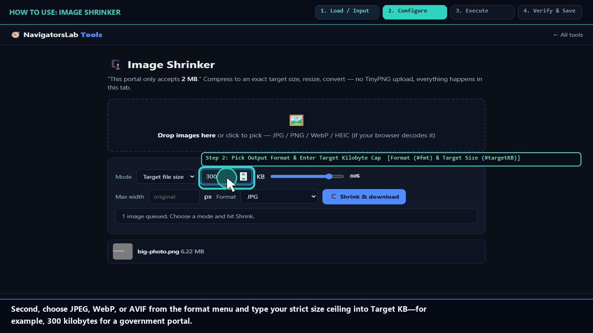
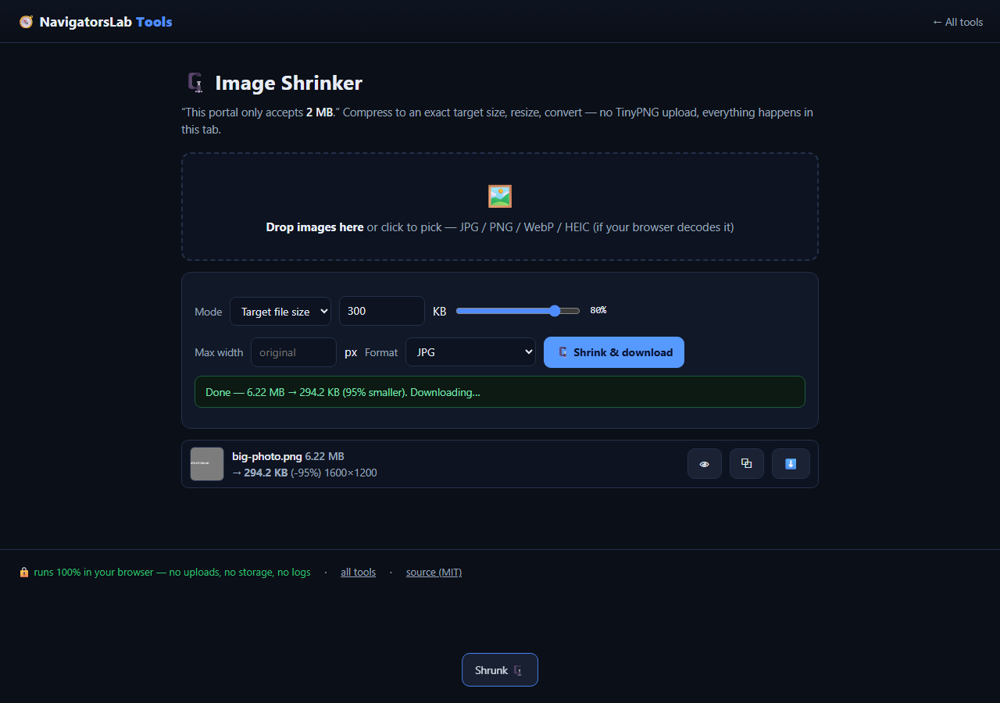

# 🗜 Image Shrinker

> Hit “max 2 MB” portal limits without TinyPNG

     

<h4 align="center">
  &#9654; <a href="https://navigatorslab.com/tools/shrink.html">Open it on navigatorslab.com</a> &mdash; free, no sign-up, nothing uploaded<br>
  <a href="https://navigatorslab.com/Image-Shrinker">navigatorslab.com/Image-Shrinker</a> &middot; <a href="https://navigatorslab.com/tools/videos/shrink.mp4">🔊 Watch Narrated Step-by-Step Tutorial Video</a> &middot; <a href="https://navigatorslab.com/tools/videos/notebooklm-overview.mp4">Watch Full Suite Hands-On Video</a><br>
  This repo's Pages site runs the <em>actual tool</em>: <code>demo.html</code>
</h4>



Hit portal size limits with a binary-searched quality target — JPG, WebP or AVIF, batch zip, per-file progress that survives broken images.

## 📖 Complete Step-by-Step User Guide

### Step 1: Drop One or More Large Images (`Batch Dropzone (#dz)`)
- **How to do it:** Drop one or more large images (for example, a 16 MB camera photo or high-DPI scan) onto `#dz`, or click to select a batch from your computer.
- **Expected result:** Each image's original dimensions and byte size are listed.

### Step 2: Pick Output Format & Enter Target Kilobyte Cap (`Format (#fmt) & Target Size (#targetKB)`)
- **How to do it:** Select your output format (`JPEG`, `WebP`, or `AVIF`) in `#fmt` and type your maximum allowed file size in kilobytes into `#targetKB` (e.g., `300` for a 300 KB portal limit, or `1024` for 1 MB).
- **Expected result:** Target byte ceiling and encoder format are locked in (also deep-linkable via `?format=webp&targetKB=300`).

### Step 3: Click Shrink & Download to Binary-Search Quality (`Shrink Button (#go)`)
- **How to do it:** Click **Shrink & download (`#go`)**. The engine binary-searches Canvas encoder quality (and gently steps down dimensions only if required) until the encoded output lands at or below your target KB.
- **Expected result:** Highest possible visual quality that fits strictly beneath your byte cap.

### Step 4: Save Individual Images or a Batch ZIP (`Output List (#list) & ZIP Download`)
- **How to do it:** Check the percentage reduction and exact final kilobyte count on each row in `#list`, then save individual files or click **Download all as .zip**.
- **Expected result:** Every output file is guaranteed to pass strict upload size limits on the first try.

## 🎛️ UI Controls, Shortcuts & Parameters Reference

| Control / Shortcut | What It Does |
|---|---|
| `Target KB (`#targetKB`)` | Exact maximum file size in kilobytes (e.g., `200`, `300`, `500`, `2000`). |
| `Output Format (`#fmt`)` | Choose `image/jpeg` (universal compatibility), `image/webp` (smaller at same quality), or `image/avif`. |
| `Max Dimension Cap (`#maxDim`)` | Optional maximum width/height in pixels before quality binary search begins. |
| `URL Deep-Link Params` | Pre-fill settings via `?format=webp&targetKB=300`. |

## 💡 Pro Tips & Real-World Workflows

- 💡 For visa, passport, and government portals that require JPEG under 240 KB or 300 KB, select `JPEG` and set Target KB to `235` or `295` for a safety margin.
- 💡 For web publishing and blog hero images, choose `WebP` with a `150` KB target to cut page weight by 85–95% without visible blur.
- 💡 Batch-drop 20+ product photos at once—Image Shrinker processes them sequentially in your tab and exports one `.zip`.

## 🧪 Concrete Example: Input → Engine → Output

| Stage | What Happens | Details |
|---|---|---|
| **1. Raw Input** | **passport-scan.png (16.0 MB, 4000×3000)** | Government / Visa portal rejects upload: 'Maximum attachment size is 300 KB' |
| **2. On-Device Engine** | **8-Step Binary Search over JPEG/WebP/AVIF encoder quality on HTML5 Canvas to land just below target ceiling** | Runs 100% client-side in your browser tab under strict `CSP` (`connect-src 'none'`). |
| **3. Verified Output** | **passport-scan.shrunk.jpg (294 KB)** | 98.1% reduction (16.0 MB → 294 KB ≤ 300 KB target) · Crisp legibility preserved · Batch ZIP ready |

```text
Target: <=300 KB | Binary Search: q=0.50 -> q=0.72 -> q=0.68 | Output: 294,112 bytes [OK]
```

- 🔊 **Narrated Step-by-Step Usage Tutorial Video (`36s`):** [`demo.mp4`](./demo.mp4) (also live at [`https://navigatorslab.com/tools/videos/shrink.mp4`](https://navigatorslab.com/tools/videos/shrink.mp4))
- 🎬 **Full Suite Hands-On Video Guide:** [`https://navigatorslab.com/tools/videos/notebooklm-overview.mp4`](https://navigatorslab.com/tools/videos/notebooklm-overview.mp4)

## ✅ What it does

- Hit an exact size target (e.g. "under 300 KB") with smart binary-searched quality
- JPEG, WebP and AVIF output; batch processing with ZIP download
- Live preview and per-file progress that survives unreadable images

## 🚀 Try it in 30 seconds

1. Drop a batch of images
2. Type the target: "under 300 KB"
3. Download the results as one ZIP

## 📸 Live UI in action



## 🔒 Private by design

- **100% on-device** — files are processed in your browser and **never uploaded** to any server
- **No accounts, no tracking, no cookies, nothing retained** — open the page and work
- **Works offline** once loaded; fully mobile-friendly
- **Free & open source (MIT)** — use it at home, at work, anywhere

## 🤖 Built for humans *and* AI agents

- Deep-linkable via URL parameters — see the [Agent Mode guide](https://navigatorslab.com/tools/agents.html)
- Machine-readable catalog: [llms.txt](https://navigatorslab.com/tools/llms.txt) · [llms-full.txt](https://navigatorslab.com/tools/llms-full.txt)
- MCP endpoint: `POST https://navigatorslab.com/tools/mcp` (tool catalog + deterministic text tools — see the [main repo](https://github.com/Kayforkind/NavigatorsLab-Tools))
- No build step required to *use* any tool — just the URL

## 🛠 Under the hood

Canvas re-encode with binary-searched quality targeting

Third-party components are catalogued in [NOTICE](NOTICE); this repo is MIT-licensed ([LICENSE](LICENSE)).

## 🗂 The NavigatorsLab Tools suite

The full catalog — every tool in the hub with the same zero-upload promise, plus the lab's apps, CLIs and engines:

| Tool | What it does | |
|---|---|---|
| 🛡 Photo Privacy Kit | Strip GPS, camera model and timestamps before posting | [Open](https://navigatorslab.com/tools/exif.html) |
| 🔐 Password Breach Checker | Has this password been breached? — it never leaves your tab | [Open](https://navigatorslab.com/tools/breachcheck.html) |
| 🔍 Metadata & Hidden-Data Checker | See what's really inside a file — then strip it | [Open](https://navigatorslab.com/tools/metadata.html) |
| **🗜 Image Shrinker** | Hit “max 2 MB” portal limits without TinyPNG | [Open](https://navigatorslab.com/tools/shrink.html) |
| 📄 Scan & Screenshot Cleaner | Phone photos of documents → clean, straight PDFs | [Open](https://navigatorslab.com/tools/scan.html) |
| ✍ Local E-Sign Pad | Sign this lease tonight — not DocuSign | [Open](https://navigatorslab.com/tools/sign.html) |
| 🧾 Receipts → One PDF | Shoebox of receipt photos → one date-sorted PDF | [Open](https://navigatorslab.com/tools/receipts.html) |
| 🔢 Receipt OCR → CSV | Read totals off receipt photos, export for expenses | [Open](https://navigatorslab.com/tools/ocr.html) |
| 🔳 QR Studio | Generate QR codes and decode QR images — no site sees them | [Open](https://navigatorslab.com/tools/qr.html) |
| 🎧 Audio Trimmer | Cut voice notes and clips on a waveform | [Open](https://navigatorslab.com/tools/audio.html) |
| 🧮 Invoice / Quote Generator | One-person shops: hours in, clean PDF out | [Open](https://navigatorslab.com/tools/invoice.html) |
| 🗂 Batch Rename & Sort | IMG_5847.jpg → 2026-09-05-receipt-home-depot.jpg | [Open](https://navigatorslab.com/tools/rename.html) |
| 🖨 Print-Shop Prep | Exact sizes, bleed, DPI checks, print-ready PDF | [Open](https://navigatorslab.com/tools/printprep.html) |
| 📑 PDF Pages | Reorder, rotate, delete and extract PDF pages | [Open](https://navigatorslab.com/tools/pdfpages.html) |
| 🔬 Text Diff | Compare two texts with word-level highlights | [Open](https://navigatorslab.com/tools/textdiff.html) |
| 🎨 Reimagine | Redesign any HTML page from its own content | [Open](https://navigatorslab.com/reimagine/) |
| 📊 Text Stats | Words, reading time, readability, keyword density | [Open](https://navigatorslab.com/tools/textstats.html) |
| 📜 PDF Studio | Edit the text inside your PDF — private, free, open source | [Open](https://navigatorslab.com/pdf-studio/) |
| 🩺 Design Health | 18 deterministic design-quality checks for HTML — no LLM, no API key | [Open](https://github.com/Kayforkind/design-health-action) |
| 🔪 Skill Slice | Copy one Read-verified skill folder — a slice, not the pie | [Open](https://github.com/Kayforkind/skill-slice) |
| 🕵 liecatchers | Your agent said Done. Prove it — ten sensors, one RECEIPT.json | [Open](https://github.com/Kayforkind/liecatchers) |
| 📚 Book Guide MCP | Ship improvements with your books — agents cite, run playbooks, learn | [Open](https://github.com/Kayforkind/book-guide-mcp) |
| 📡 Data Insights | Founder intelligence — daily & weekly tech signal briefs | [Open](https://github.com/Kayforkind/data-insights) |
| 🪓 Iron Axe: Legacy | An original side-scrolling beat 'em up — Godot 4 | [Open](https://github.com/Kayforkind/iron-axe-legacy) |

---

<p align="center">
  <b>One hub, twenty-four projects:</b> <a href="https://navigatorslab.com/tools/">https://navigatorslab.com/tools</a><br>
  <b>Source &amp; the whole suite:</b> <a href="https://github.com/Kayforkind/NavigatorsLab-Tools">https://github.com/Kayforkind/NavigatorsLab-Tools</a>
</p>
